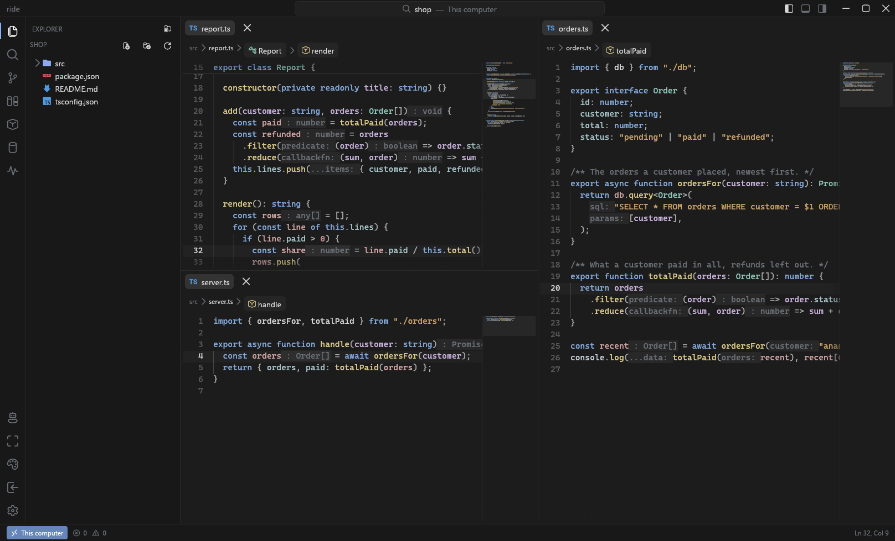
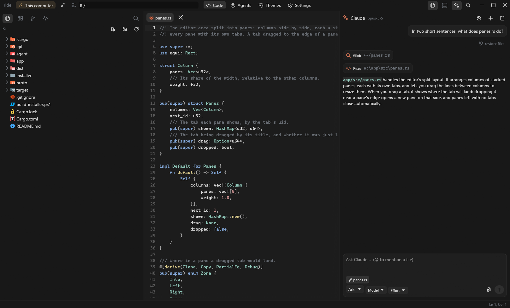
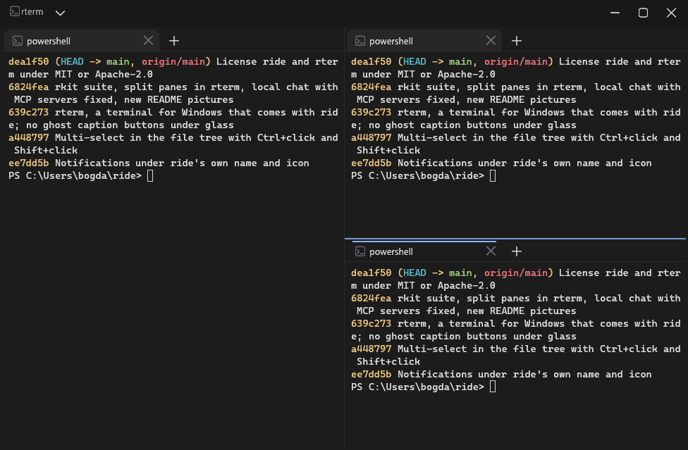

<p align="center">
  
</p>

<h1 align="center">ride</h1>

<p align="center">
  A code editor for working on servers over SSH, with Claude Code built in.<br>
  Part of <b>rkit</b>, with <a href="#rterm">rterm</a>, a terminal for Windows.
</p>

<p align="center">
  <a href="https://github.com/raisen1337/rideide/releases/latest"></a>
  <a href="https://github.com/raisen1337/rideide/releases"></a>
  <a href="https://github.com/raisen1337/rideide/commits/main"></a>
  
  
  
</p>

<p align="center">
  
</p>

ride opens a folder on a server the way you'd open one on your own disk. It connects with the
hosts already in your `~/.ssh/config`, uploads a small agent to the server, and from then on the
file tree, editor, terminal and search all work on the server directly — no syncing, no mounting.
It runs on your own computer as well.

## Download

Get **`rkit-setup.exe`** from the [latest release](https://github.com/raisen1337/rideide/releases/latest)
and run it. It installs rkit: ride and [rterm](#rterm), in your user folder, so it doesn't ask
for admin rights.

After that ride keeps itself current. Each time it opens it checks the latest release here; a
newer version is downloaded, checked against its SHA-256 and installed, and ride restarts into it
with your tabs and chats. One that turns up while you work installs when you close ride. A short
"What's new" from [CHANGELOG.md](CHANGELOG.md) shows once after each update. Settings → Updates
turns this off or checks by hand.

You need:

- Windows 10 or 11 (the OpenSSH client that comes with Windows is enough)
- A Linux x86_64 server you can reach with `ssh <host>`
- [Claude Code](https://docs.claude.com/en/docs/claude-code) installed and logged in on that server, for the chat

## Claude



The chat runs the Claude Code that's installed on the server, with the account logged in there.
There is no API key to paste into ride.

- **Ask** asks before Claude changes a file or runs a command, and shows you the diff or command
  first. **Edit** lets it edit freely and asks only for commands.
- Every message you send is a checkpoint: **restore files** puts back what Claude edited after it.
- Paste screenshots with Ctrl+V or attach images.
- **Agents** runs several Claude sessions side by side, each with its own task.
- When Claude builds something with a web page, it can open a preview for you: ride forwards the
  port from the server and opens it in your browser.

## Editor

- Language servers, the same ones VS Code uses, running on the server next to the code:
  completion as you type, problems underlined as you go, hover, the arguments of the call
  you're typing, go to definition (F12 or Ctrl+click), find references (Shift+F12), rename
  across files (F2) and quick fixes (Ctrl+.). TypeScript/JavaScript, Python, Lua, Rust, Go,
  C/C++, PHP, JSON, CSS, HTML, Bash and YAML are set up; ride offers to install a server the
  first time a file needs one, and you can add others in Settings.
- Inlay hints (the types and parameter names the server works out, faintly in the code) and
  semantic highlighting (a parameter, a field, a constant and a type each in their own colour).
- Sticky scroll: the first lines of the function and blocks you're scrolled into stay pinned
  above the code.
- Indent guides, matching brackets, rulers, visible whitespace, and brackets and quotes that
  close themselves.
- Every keyboard shortcut can be changed in Settings, which also has a search box.
- Search and replace in the whole folder (Ctrl+Shift+F, Ctrl+Shift+H), with regular
  expressions, a preview of each change, and files left out with a click.
- Split the editor into columns and rows by dragging a tab to the edge of another pane.
- Code folding, a minimap, breadcrumbs, and an outline of the file's functions and types
  (Ctrl+Shift+O to jump to one).
- Format on save, with the formatter of your choice per file type, run on the server. Prettier
  and StyLua work out of the box through npx.
- Without a language server, syntax errors on open and save for Lua, JavaScript, Python, PHP,
  shell and JSON, using the checkers already on the server (`luac`, `node`, `python3`, `php`, `bash`).
- Compare any two files side by side.
- `.env` files open as a table, with the values hidden until you show them.
- The Command Palette (Ctrl+Shift+P) can search the VS Code Marketplace for themes and file icons,
  and previews them before you install one.

## Designer

- Claude designs interfaces in Tribib, with Tribib itself inside ride: the Designer holds the
  Tribib app's own window in its middle, with the chat at the right. Each design session is a chat
  with a Tribib document of its own. Ask for the result as code and it goes into your project.
- Any MCP server can be given to Claude in Settings. One running on your computer is reached from
  the server Claude runs on through an SSH tunnel ride opens.

## Working together

- **Live sessions.** Share the folder you have open with people who have no access to the server.
  You get a session ID to send them; they paste it into ride, you let each one in, and you edit
  the files together. Their requests go through your ride, which only lets them reach files in
  that folder: no terminal, Git or Claude. Stop the session and everyone is out.
- The two copies of ride connect directly to each other over an encrypted link
  ([iroh](https://github.com/n0-computer/iroh)). When no direct path can be found, the traffic
  goes through a public relay, still encrypted end to end.
- People who log in to the same server with the same account edit together without a session.
- Others see your nickname on your cursor, or your GitHub name and picture if you sign in with
  GitHub (Settings → Account). Neither needs an account anywhere else.

## Git, server and databases

- A Git panel: stage, unstage, discard, commit, pull and push, with changed lines marked in the
  gutter. Switch, check out and create branches, stash changes, and see who last changed the
  line you're on. Claude can write the commit message.
- A database explorer for MySQL, MariaDB and PostgreSQL on the server. Open a table to page
  through it, sort by any column, search every column or filter with a WHERE, and edit it in
  place: double-click a cell, add, duplicate and delete rows, then save it all as one
  transaction. Select rows and cells as in a spreadsheet and copy or export them as CSV, JSON
  or SQL. Query tabs run any SQL. It can take the connection from your `.env`.
- A server panel with CPU, memory, disk, PM2 processes and listening ports; forward any port to
  `localhost` in one click.
- Open several connections at once and drag files and folders from one server's tree to another's.
- The folder and open tabs, unsaved changes included, come back the next time you open ride.
- Themes and VS Code icon themes, and ride updates itself from this repository's releases.

## rkit

The setup program installs rkit, the suite's hub, beside ride and rterm. Each app still starts
on its own from the Start menu and Explorer; rkit puts them in one place:

- Open ride, rterm or rdrop, open a folder in ride, or start any of rterm's shells.
- Reopen the folders you used lately in ride, on this computer or on a server.
- Every server in your `~/.ssh/config`, one click from ride, rdrop or an SSH session in rterm.
- Updates for each app on its own, with its changelog: see what's new, then update just that app.

## rdrop

rdrop moves files between this computer and your servers, and from one server to another,
over SFTP. It signs in the way `ssh` does, so your `~/.ssh/config`, keys, agent and jump hosts
all apply, and it works with any server that has SFTP. Servers that want a password get one:
save sites with their user and password, or be asked when you connect, and remembered
passwords are encrypted by Windows for your account.

- As many panes as you like, each on this computer or on any server. Drag a pane by its header
  to the edge of another to put it there, drag a server from the list onto a pane to open it
  beside, and drag the lines between panes to resize.
- Drag rows from one pane onto another to copy them, or files from Explorer onto a pane. Server
  to server goes straight across, without a stop on this computer's disk. Folders copy with all
  they hold, and files keep their modification times.
- Folders go as one compressed stream through ssh, packed and unpacked by tar on the server:
  400 small files go up in under a second, where file by file over SFTP (as other clients
  do it) takes about a minute. Servers without a shell or tar get the folder over SFTP.
- Transfers run in the background, three at a time, while you keep browsing; the bar at the
  bottom shows how far they are and opens the full list.
- It works like Explorer: Ctrl+C, Ctrl+X and Ctrl+V (with Explorer's own clipboard), Delete to
  the Recycle Bin and Shift+Delete for good, F2 or a slow click to rename in place, This PC with
  the drives, large icons with thumbnails, and the arrow keys and typing to move through a list.
- Double-click a file to see it: pictures, sound with a player, code in colour, logs that follow
  what is written to them, and the bytes of anything else. Files on a server open in their app
  and go back up when saved.
- Permissions on servers, shown and changed from Properties; hidden files with Ctrl+H.

## rterm

ride comes with rterm, a terminal for Windows made from ride's own terminal. It is a separate
app, in the Start menu as rterm and in Explorer's right-click menu as "Open in rterm" on folders.



- Tabs of PowerShell, PowerShell 7, Command Prompt, Git Bash, each WSL distribution and every
  host in `~/.ssh/config`, found on their own. Pick the one new tabs open with in the menu beside
  the tabs.
- Lay the window out as a grid of panes, each with its own tabs: drag a tab to the edge of any
  pane to split it there, or into another pane's tabs to move it. Alt+Shift+= splits beside,
  Alt+Shift+- below, Alt+Shift+D along the longer side. Alt and an arrow moves between panes;
  drag the lines between them to resize.
- ride's themes and its glass, if you like the desktop showing through.
- Ctrl+Shift+T opens a tab in the pane you're in, Ctrl+Shift+W closes it, Ctrl+Tab moves between tabs,
  Ctrl+Shift+1…9 opens a profile and Ctrl+Alt+1…9 goes to a tab. Ctrl+Shift+D duplicates the
  tab and Ctrl+Shift+N opens a new window. Ctrl+= and Ctrl+- size the text, as does Ctrl+wheel.
- Ctrl+C copies when text is selected and interrupts otherwise; Ctrl+V pastes. A right click
  copies the selection or pastes, as in the Windows console. Files dropped on it are typed in as
  their paths.
- `rterm [-d FOLDER] [-p PROFILE] [COMMAND ARGS…]` starts in a folder, with a profile, or
  running a command.

## Building from source

```powershell
rustup target add x86_64-unknown-linux-musl   # for the server agent
.\build-installer.ps1                          # writes dist\rkit-setup.exe
```

`cargo run -p ride` starts the editor without installing it.

Each app has its own version (in its `Cargo.toml`) and changelog: `CHANGELOG.md` for ride,
`rterm/CHANGELOG.md`, `rdrop/CHANGELOG.md` and `rkit/CHANGELOG.md`. To release, add an entry for each app that changed,
raise its version, raise the suite's `version` in the root `Cargo.toml` and push to `main`. The
[Release workflow](.github/workflows/release.yml) tests and builds on GitHub's Windows runners,
then `tools/manifest.py` writes `apps.json` (each app's version, program and changelog, for
rkit) and `latest.json` (for ride's own updates), published with `rkit-setup.exe` and the
programs.

| Folder | What it is |
| --- | --- |
| `app/` | The editor (Rust, [egui](https://github.com/emilk/egui)) |
| `agent/` | The helper ride uploads to the server; also an MCP server Claude uses for previews |
| `proto/` | The protocol between the two |
| `rterm/` | The terminal that comes with ride |
| `rkit/` | The hub that starts the apps and updates each on its own |
| `rdrop/` | Files between this computer and servers, over SFTP |
| `tools/` | `manifest.py`, which writes a release's `apps.json` and `latest.json` |
| `installer/` | The Windows setup program |

## License

ride, rterm, rdrop and rkit are free and open source, under either of

- the [Apache License, Version 2.0](LICENSE-APACHE), or
- the [MIT license](LICENSE-MIT),

at your option. Contributions are taken under the same terms.
